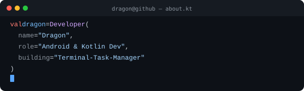

 

  

---

## 🦊 About me

Hi! I'm **Dragon**, an independent developer who enjoys turning ideas into useful software.

- 📱 Focused on **Android development** with Kotlin and Jetpack Compose
- 🔐 Interested in **privacy-first** and **offline-first** app experiences
- 🎨 I enjoy building clean interfaces with **Material 3**
- 🌍 Working on app localization across **50 languages**
- 🤖 Exploring AI-assisted development with **Google AI Studio**
- 🧩 Interested in architecture, usability, and practical problem-solving

> I believe good software should be useful, thoughtful, and respectful of its users.

## 🧭 What I work with

| Area | Technologies & tools |
|:--|:--|
| **Languages** | Kotlin · Java |
| **Android UI** | Jetpack Compose · Material 3 |
| **Architecture & storage** | MVVM · Room |
| **Camera & QR** | CameraX · ZXing |
| **Async** | Coroutines · Flow |
| **Networking** | Retrofit · OkHttp · Moshi |
| **Build & workflow** | Android Studio · Gradle · Git · GitHub Actions |

## 🚀 Featured projects

### 📱 [QR Code Studio](https://github.com/Dragons-Fox0058/qr-code-studio)

A privacy-focused Android app for scanning and generating QR codes.

| Feature | Details |
|:--|:--|
| Platform | Android |
| Main language | Kotlin |
| UI toolkit | Jetpack Compose + Material 3 |
| Architecture | MVVM |
| Local storage | Room |
| QR engine | ZXing |
| Localization | 50 languages |
| Appearance | 7 themes |
| Development | Active |

**Project documentation:** [Architecture](https://github.com/Dragons-Fox0058/qr-code-studio/blob/main/ARCHITECTURE.md) · [Roadmap](https://github.com/Dragons-Fox0058/qr-code-studio/blob/main/ROADMAP.md) · [FAQ](https://github.com/Dragons-Fox0058/qr-code-studio/blob/main/FAQ.md)

### 🤖 [Aternos AI Bot](https://github.com/Dragons-Fox0058/aternos-ai-bot)

An AI-powered virtual player project designed for an Aternos server.

## 🧰 Tech stack

**Languages**

**Android & development**

**Tools & workflow**

## 📊 GitHub at a glance

Your profile statistics, language breakdown, contribution calendar, coding activity, and achievements are generated as a **local SVG** by GitHub Actions. This removes the external image-hosting dependency from the profile.

**One-time setup:** Create a GitHub personal access token for reading public profile data, then add it to this repository under **Settings → Secrets and variables → Actions** with the name `METRICS_TOKEN`. After adding the secret, open **Actions → Update profile metrics → Run workflow**. The workflow also refreshes the image every day.
## 🎯 Current interests

- Building thoughtful Android experiences
- Improving app architecture and maintainability
- Making applications more accessible through localization
- Exploring practical AI-powered tools
- Learning by shipping real projects

## 🤝 Connect

I'm always happy to connect with developers and people who enjoy building things.

  

**If something here catches your eye, feel free to explore the repositories!**

---

### 🐉 Build with purpose. Keep learning. Respect privacy.

<i>“Privacy first. Ads never.”</i>

